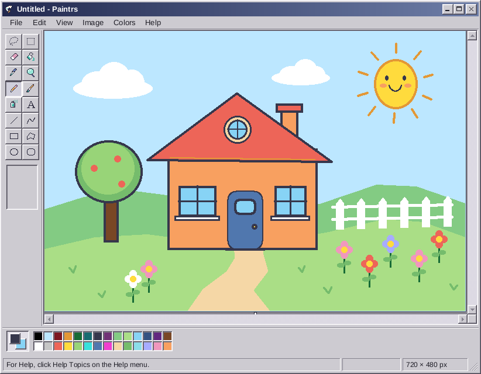

# Paintrs

An MS Paint clone written in Rust for a demonstration.



```sh
cargo run --release --locked
```

Run from the project directory on Windows, macOS, or Linux. Add `-- path/to/image.png` to open an image at launch.
From a release archive, open `paintrs.exe`, `Paintrs.app`, or `paintrs` on Linux.
